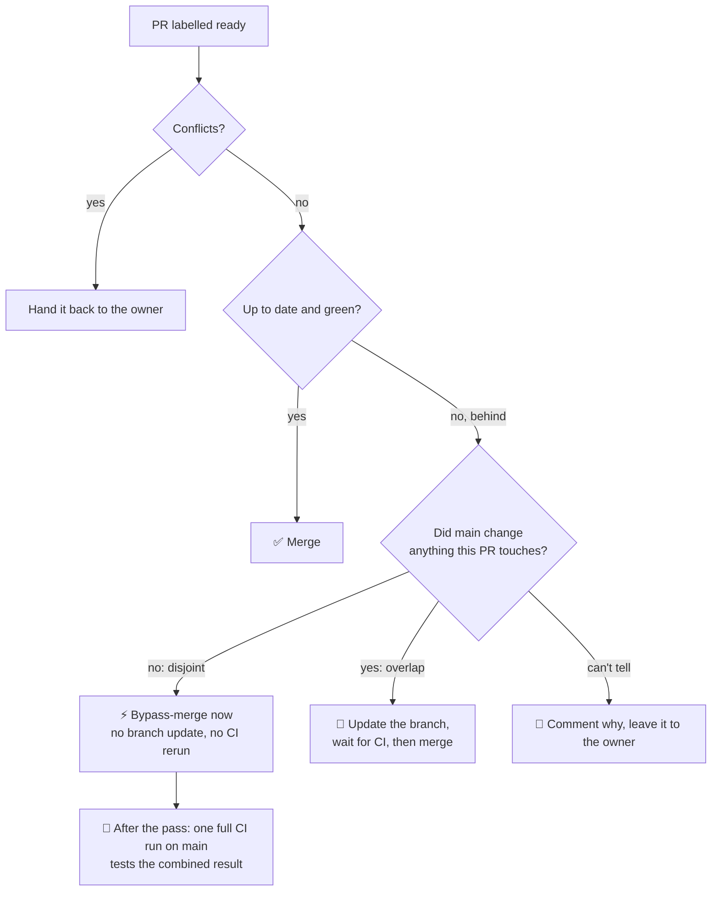

<p align="center">
  
</p>

<h1 align="center">Carl Mergé</h1>

<p align="center">
  <strong>A merge bot for repositories where several AI coding agents open pull requests in parallel.</strong><br>
  It skips the CI rerun when <code>main</code> moved but changed nothing a pull request touches.
</p>

<p align="center">
  MIT licence · Python 3.12+ · zero runtime dependencies · runs as a GitHub App
</p>

> *Carl Fabergé made jewelled eggs. Carl Mergé makes merges.*

Carl decides, pull request by pull request, whether a branch that fell behind
`main` really needs another full CI run, or whether it can merge right now,
safely, with a bypass.

It ships as a GitHub App plus one small workflow. Zero runtime dependencies.
One config file. Project-agnostic.

---

## 🚦 The problem: a traffic jam on `main`

Picture a normal day with a fleet of coding agents:

- **One issue, one branch, one pull request.** Every agent works alone and
  opens its own pull request.
- **Tests come first.** AI-written code is held to test-driven development, so
  every change brings its tests, and the suite only grows. Ours is past
  **10,000 tests**, and a full CI run takes **several minutes**.
- **Review happens on the draft.** Code review runs while the pull request is
  still a draft, so fix-ups after review do not each trigger the full suite.
  The pull request is marked ready only when review is done, and the full CI
  runs once. When it goes green, nothing is left to do but merge.
- **Branches must be up to date before merging.** That is the safe ruleset
  setting, and it is the right one.

Now watch what happens when five pull requests go green at about the same
time:

```text
09:00  PR A ✅ green  →  merged.          main moves.
       PR B ✅ green  →  now BEHIND main. update branch, run CI again ⏳ 6 min
       PR C ✅ green  →  now BEHIND main. update branch, run CI again ⏳ 6 min
       PR D ✅ green  →  now BEHIND main. update branch, run CI again ⏳ 6 min
09:06  PR B ✅ green  →  merged.          main moves.  C and D are behind AGAIN 🔁
       PR C ⏳ ...     update, run CI again ⏳ 6 min
       PR D ⏳ ...     update, run CI again ⏳ 6 min
...
```

Every merge makes everyone else stale. These pull requests are reviewed and
green; the only thing wrong with them is that `main` moved. On a heavy day this is a **merge
traffic jam**: a queue of green pull requests that keep missing the light, and
a CI bill full of runs that test nothing new. Most of those reruns were
pointless. PR C touched `reports/`, PR B touched `importer/`. Nothing PR B
changed could have broken PR C. A human maintainer would have looked at the
two diffs and pressed merge.

## 🧠 What Carl does about it

Carl is that careful maintainer. It wakes on every push to `main`, every
ready label and every finished CI run.

GitHub's **auto-merge** can already press the button for you. What it cannot
do is *think about whether CI must run again*. With "require branches to be up
to date" on, auto-merge waits for you to update the branch, then waits for the
full suite again, every time `main` moves.

Carl makes the call:



- **Disjoint?** Merge it with a bypass. No update, no rerun, no waiting.
- **Overlapping?** Update the branch and let CI earn its keep this time.
- **Not sure?** Say so and do nothing. Carl never guesses.
- **Bypassed anything?** Run the full suite once on `main` afterwards, so the
  combined code is always tested. While `main` is red, Carl merges nothing.

Five green pull requests that touch different corners of the code go in back
to back, and CI runs once on the result instead of four extra times on stale
branches.

## 🙋 Is Carl for you?

Carl earns its keep when **all** of these are true:

- ✅ Several agents (or people) push pull requests **to the same repository in
  parallel**.
- ✅ Your required CI takes **at least ~3 minutes**. Below that, just update
  and rerun; the jam clears itself.
- ✅ Your ruleset requires branches to be **up to date** before merging.

If you merge one pull request an hour, or your CI runs in 40 seconds, you do
not need Carl. GitHub's auto-merge is enough.

### What about GitHub's merge queue?

GitHub's **merge queue** solves a nearby problem: it tests each pull request
on top of the ones queued ahead of it, so nothing merges untested. Two
differences matter here:

- **Availability.** At the time of writing, merge queue is offered for
  organisation-owned repositories (public ones, and private ones on GitHub
  Enterprise Cloud). A private repository under a personal account, or a team
  on a lower plan, does not get it.
- **It still runs CI for every entry.** A merge queue makes the stale-branch
  reruns *correct*; it does not make them *fewer*. Carl's whole point is
  skipping the runs that cannot find anything new, and paying for one run on
  the combined result instead.

If you have merge queue and money for CI is no object, merge queue is a fine
choice. If you want to stop paying for reruns that test nothing new, that is
what Carl is for.

## 🚀 Getting started

Carl is on PyPI as `carl-merge`.

1. Commit the wheel, a `.github/carl-merge.toml` and a
   `.github/workflows/carl-merge.yml`. Start from the files in
   [`examples/`](examples/). One command fetches the wheel:

   ```bash
   python3 -m pip download carl-merge==0.1.1 --no-deps --only-binary :all: -d vendor/
   ```

2. Run `uvx carl-merge create-app --repo OWNER/NAME`. It creates your own GitHub
   App with the right permissions and stores its keys in the repository. Then
   upload the logo it leaves next to you, install the App, and add it to your
   branch ruleset's bypass list in `pull_request` mode.
3. Leave `dry_run = true` for a first batch, read what Carl says it *would*
   do, then switch it off.

Every step, every permission and every setting is in the
**[technical guide](docs/guide.md)**:

- [How it decides, exactly](docs/guide.md#1-how-it-decides-exactly)
- [Adopting it](docs/guide.md#2-adopting-it)
- [The GitHub App](docs/guide.md#3-the-github-app)
- [The ruleset](docs/guide.md#4-the-ruleset)
- [What it cannot see](docs/guide.md#5-what-it-cannot-see)
- [Configuration reference](docs/guide.md#6-configuration-reference)
- [Dry run first](docs/guide.md#7-dry-run-first)
- [Development](docs/guide.md#8-development)

## 📄 Licence

[MIT](LICENSE). Use it, fork it, and adapt it to your own forge.
